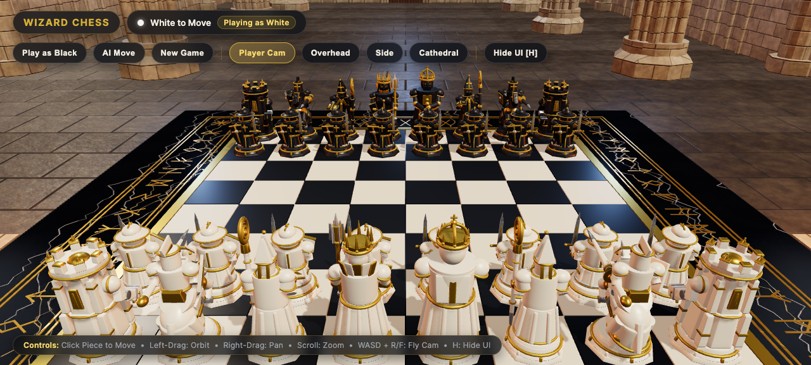
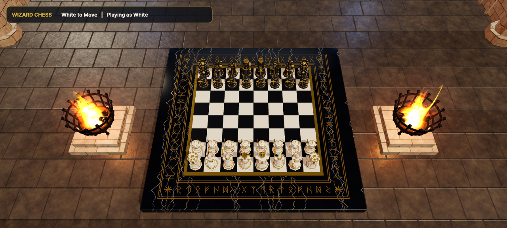
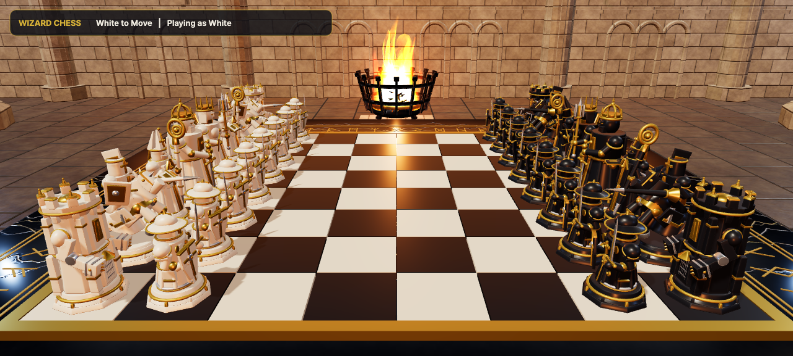
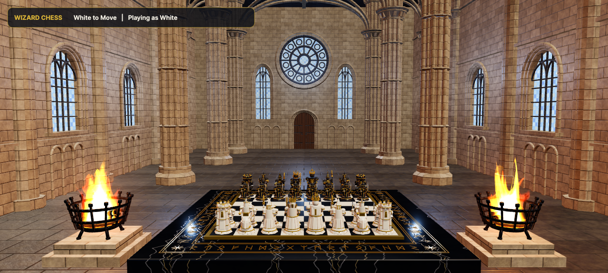
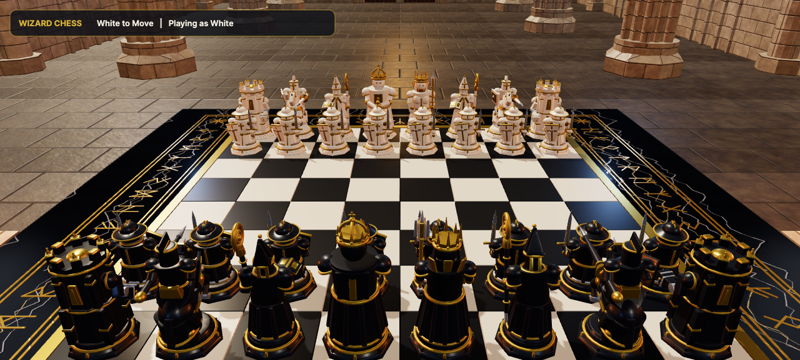

<div align="center">

# Wizard Chess 3D

**A gothic cathedral chess sanctum — sculpted stone armies, cinematic melee captures and real-time stone-shatter physics, rendered in the browser with Three.js.**

</div>



## Overview

Wizard Chess 3D is a playable 3D chess game set inside a candle-lit Gothic cathedral. Two sculpted armies of stone — ivory and obsidian with gold filigree — face each other across an obsidian altar. Every capture is a short cinematic: the attacker charges, the defender is struck, and its body bursts into stone shards that tumble across the board.

The whole scene runs in a single WebGL canvas, with fully procedural lighting, braziers, stained-glass windows and a playable chess engine underneath.

## Screenshots

| Overhead board view | Side profile |
| --- | --- |
|  |  |

| Wide cathedral view | Playing as Black |
| --- | --- |
|  |  |

## Features

- **Complete chess rules** — legal move generation, check, checkmate and stalemate, with per-side turn tracking.
- **Cinematic captures** — melee strike trajectories with occlusion-aware camera framing, stone-shatter particle bursts and a captured-piece tray.
- **King fall sequence** — on checkmate the defeated King topples from its pedestal, shatters its crown and triggers a "Sanctum Judgment" banner.
- **Four camera presets** — Player, Overhead, Side and wide Cathedral views, each flippable to the opposite side with a second click.
- **Free-fly camera** — WASD + R/F flying, orbit, pan and zoom with collision against the cathedral columns and bounds.
- **Single-player AI** — play as White or Black against the built-in engine, or let the AI move on demand.
- **Notation scripting** — load a PGN/notation sequence and step through it move by move.
- **Material presets** — swap cathedral wall and floor stone looks at runtime.
- **Responsive HUD** — desktop HUD and a mobile control sheet with touch gestures, plus a cinematic "hide UI" mode.
- **Zero external services** — everything, including asset loading and physics, runs locally in the browser.

## Tech stack

| Layer | Technology |
| --- | --- |
| Rendering | Three.js (`WebGLRenderer`, PMREM environment, custom shaders) |
| UI | React 19 + TypeScript |
| Build | Vite 8 |
| Models | glTF / GLB piece and architecture assets |
| Rules | Self-contained chess engine in `src/wizardChessEngine.js` |

## Getting started

**Requirements:** Node.js 18+ (npm, or bun if you prefer).

```bash
npm install
npm run dev
```

Open http://localhost:3000 — the sanctum loads its stone assets first, then the board becomes playable.

Production build:

```bash
npm run build
npm run preview
```

### Optional: Gemini API key

`vite.config.ts` exposes `GEMINI_API_KEY` as `process.env.API_KEY` for the Google GenAI SDK. The current build does not call any model, so no key is required to play.

## Controls

| Action | Desktop | Touch |
| --- | --- | --- |
| Select / move a piece | Click the piece, then a highlighted square | Tap piece, then tap target |
| Orbit camera | Left drag | One-finger drag |
| Pan camera | Right drag | Two-finger drag |
| Zoom | Scroll | Pinch |
| Fly camera | `W` `A` `S` `D`, `R` / `F` for up / down | — |
| Hide HUD | `H` | Controls → Hide UI |
| Close overlay | `Esc` | Controls → Close |

Camera preset buttons (`Player Cam`, `Overhead`, `Side`, `Cathedral`) stay highlighted while active; click the active one again to view from the opposite side of the board.

## Project structure

```
.
├── index.html                  # Page shell and meta tags
├── src
│   ├── main.tsx                # React entry point
│   ├── App.tsx                 # HUD, loading overlay and React state
│   ├── styles.css              # HUD, mobile sheet and banner styling
│   └── wizardChessEngine.js    # Three.js scene, chess rules, animation and physics
├── public/assets/glb           # Sculpted pieces and cathedral models
├── docs/screenshots            # README screenshots
└── test                        # Engine smoke tests
```

## How it works

The engine builds the cathedral procedurally — walls, columns, braziers, stained glass and floor stone are generated or shadered at load time — then loads sculpted GLB pieces and clones them per square. Chess state lives in a plain 8×8 board array; legal moves are validated against king safety, and each executed move runs through an animation state machine that alternates between choreographed melee captures and quiet repositioning. A single `requestAnimationFrame` loop drives camera tweens, piece mixers, particles and the checkmate sequence.
